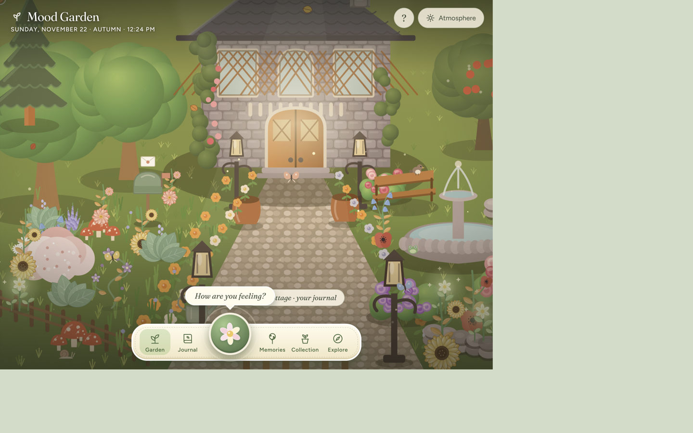
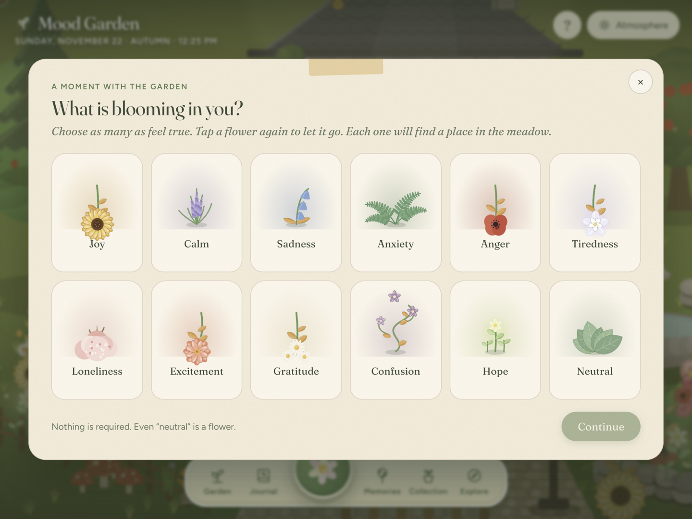
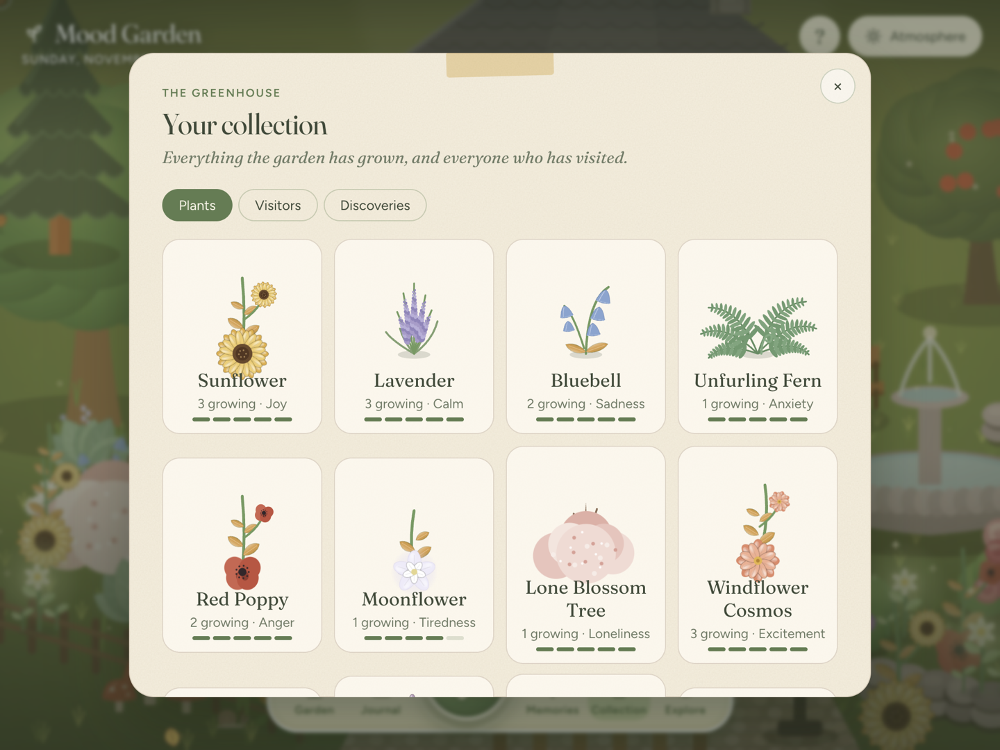

# Mood Garden

A calm, private mood garden. Works fully offline and without an account; gardens are saved in the browser.
**Live app:** [mood-garden-4rt.pages.dev](https://mood-garden-4rt.pages.dev)

Optional: sign in with an email code to sync gardens across devices.

## Screenshots

| A garden that grows with you | Pause and check in |
| --- | --- |
|  |  |

### Greenhouse collection



```bash
npm install
npm run dev      # http://localhost:5199
npm run build
```

## Hosting

**Frontend: Cloudflare Pages**

The GitHub Actions workflow validates the production build on every push and pull request. To enable automatic production deployment:

1. In Cloudflare Workers & Pages, choose **Create application -> Pages -> Connect to Git**, authorize GitHub, and select `Ayushi50/MoodGarden`.
2. Set the production branch to `main`, build command to `npm run build`, and output directory to `dist`.
3. Add `VITE_NEON_AUTH_URL` and `VITE_NEON_DATA_API_URL` as production build environment variables. Add them to preview builds only if you want sign-in and sync in previews.
4. Push to `main`; Cloudflare builds and deploys automatically.

The site remains local-only until the two `VITE_NEON_*` variables are set.

## Optional cloud sync with Neon

The app remains fully usable offline. To enable email-code sign-in and sync:

1. Link the Neon project and apply `neon.ts` with `neon deploy`.
2. Apply `neon/schema.sql` to the project's default branch.
3. Pull the public service URLs with `neon env pull --service auth --service data-api`. Copy `NEON_AUTH_BASE_URL` to `VITE_NEON_AUTH_URL` and `NEON_DATA_API_URL` to `VITE_NEON_DATA_API_URL` in `.env.local` and your hosting environment. The browser uses only these public HTTPS URLs, never a database connection string.
4. Add the deployed `https://<project>.pages.dev` origin to Neon Auth's trusted domains. Localhost is preconfigured.

The garden data table is protected by PostgreSQL row-level security: each signed-in user can access only their own rows. Email-code sign-in uses Neon's shared email provider for development; configure custom SMTP in Neon before production for reliable delivery and higher limits.

When either Neon URL is unset, the sign-in option is hidden and the app stays local-only. GitHub Actions runs the production build on pushes and pull requests.

## Release checklist

- Confirm the deployed site's Neon trusted domain and production Auth email provider.
- Set both `VITE_NEON_*` variables in the hosting provider's production environment and redeploy.
- Verify email-code sign-in, session restoration, sign-out, and garden sync across two browsers.
- Test export/restore and the offline experience.
